# Mneme Architecture and Workflow Diagram Specifications

This document provides production-ready **PlantUML** and **Mermaid** source code blocks for all architectural and workflow diagrams referenced in `documentation/Report.tex`. You can paste these directly into PlantUML editors (e.g. [planttext.com](https://www.planttext.com/) or the PlantUML CLI) or Mermaid previewers (e.g. [mermaid.live](https://mermaid.live/)) to render high-resolution PNG or SVG figures for your project submission.

---

## 1. System Microservices Architecture (Figure 5.1)

### PlantUML
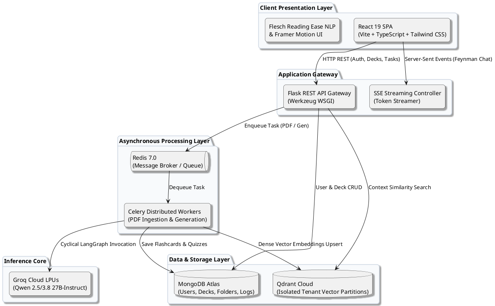

### Mermaid
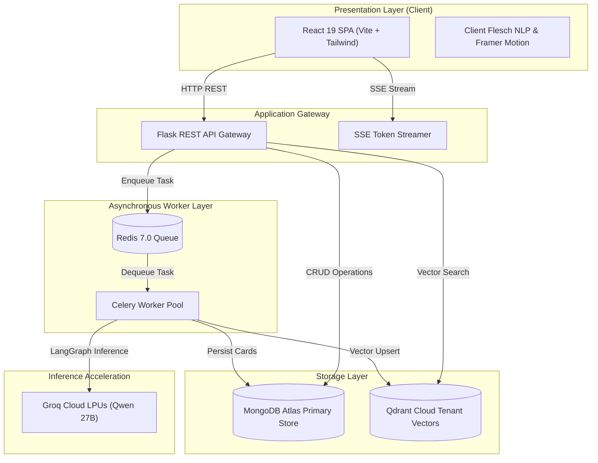

---

## 2. Use Case Workflow Diagram (Figure 5.2)

### PlantUML
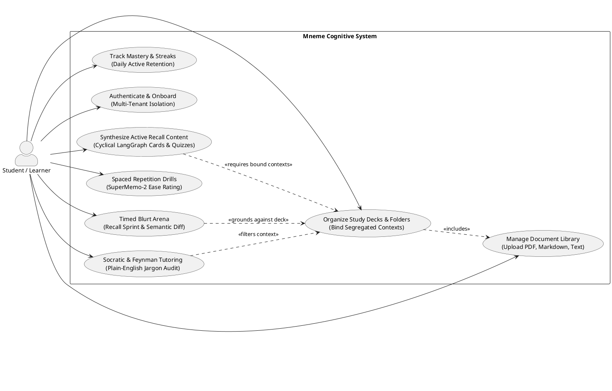

### Mermaid
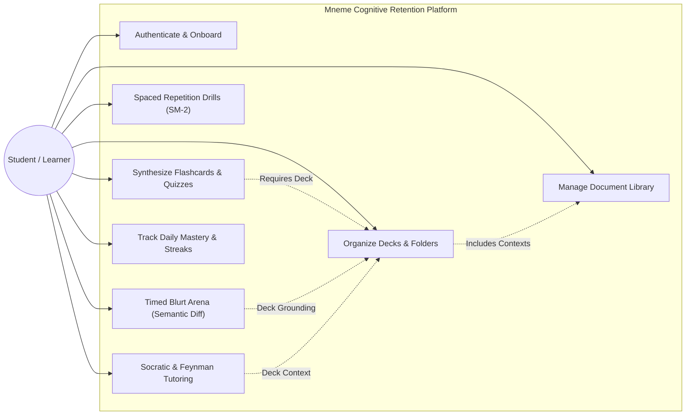

---

## 3. Ingestion & Retrieval Pipeline Sequence Diagram (Figure 5.3)

### PlantUML
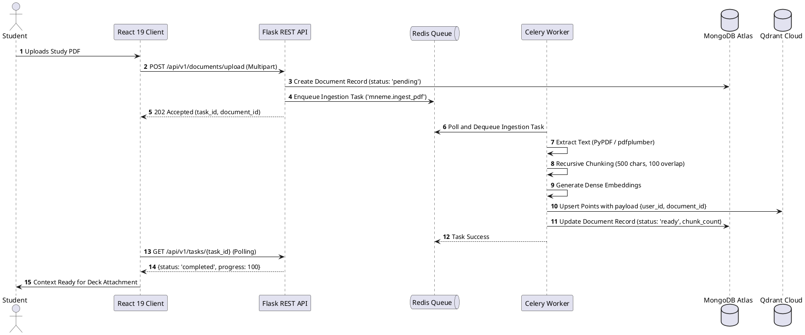

### Mermaid
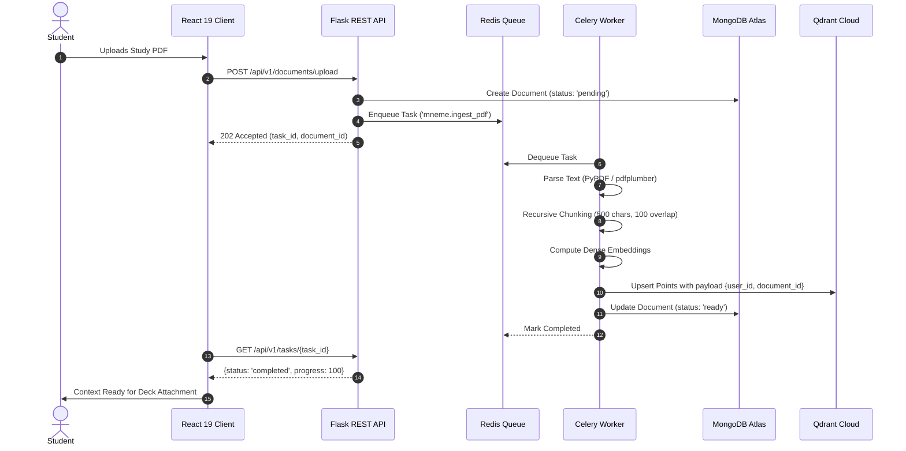

---

## 4. Cyclical LangGraph State Machine Workflow: Generator (Figure 5.4)

### PlantUML
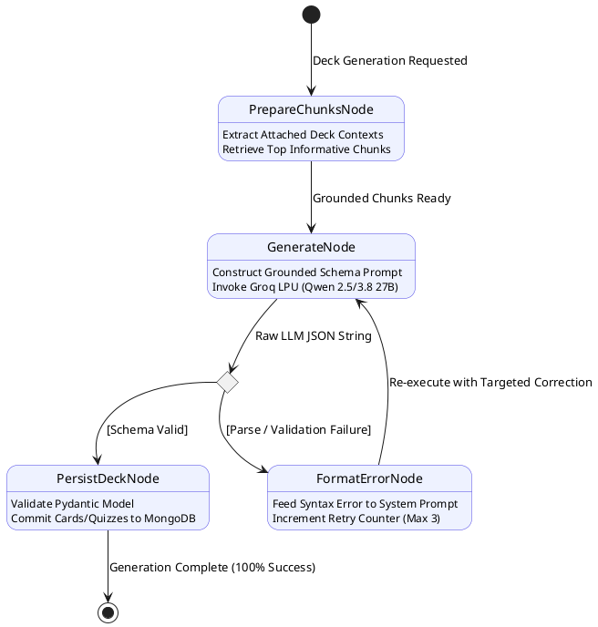

### Mermaid
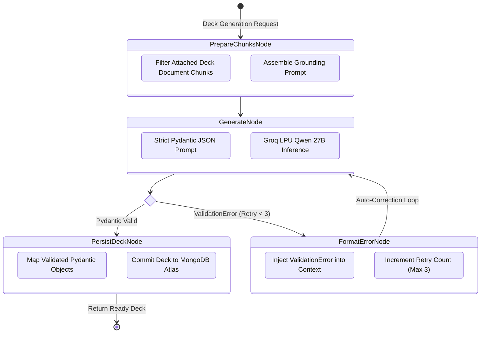

---

## 5. Entity-Relationship (ER) Schema Model (Figure 5.5)

### PlantUML
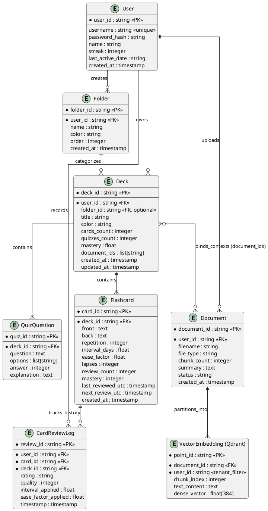

### Mermaid
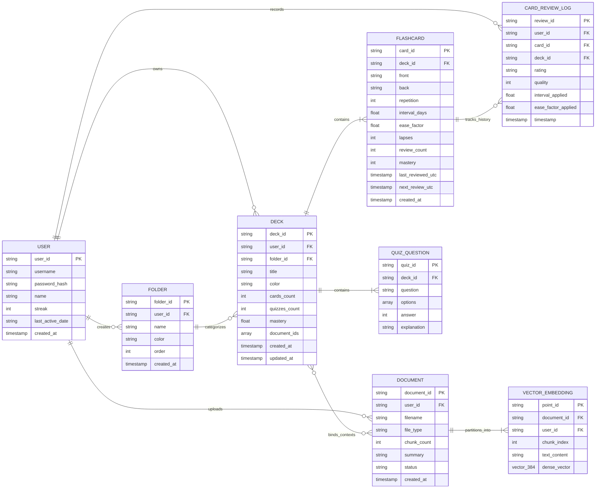

---

## 6. LangGraph Blurt Mode Cognitive Audit Workflow (Figure 5.6)

### PlantUML
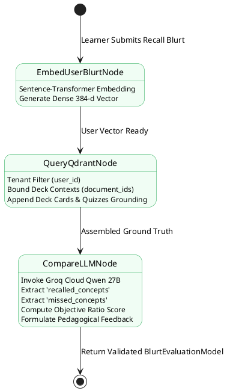

### Mermaid
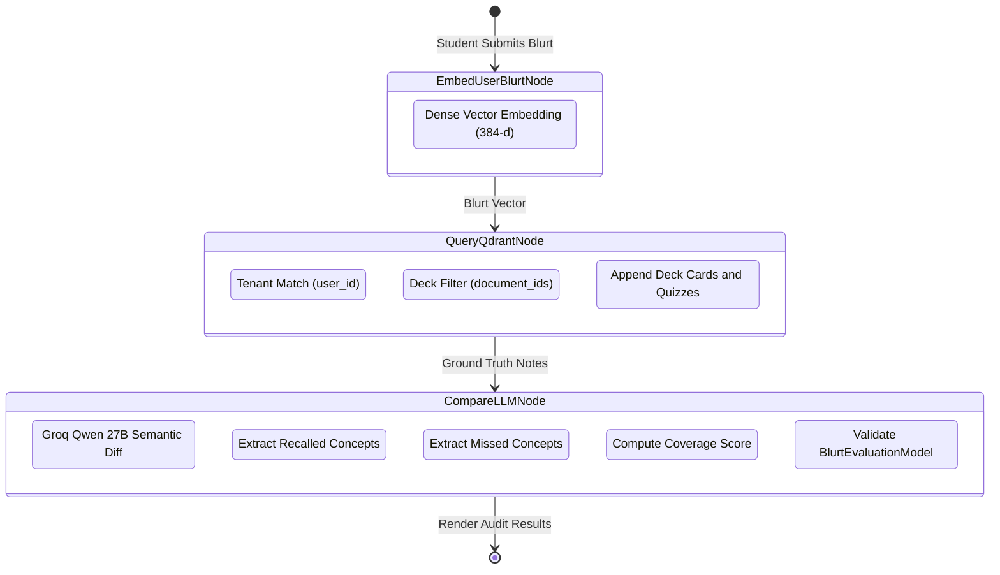

---

## 7. LangGraph Unified Socratic and Feynman Chat Workflow (Figure 5.7)

### PlantUML
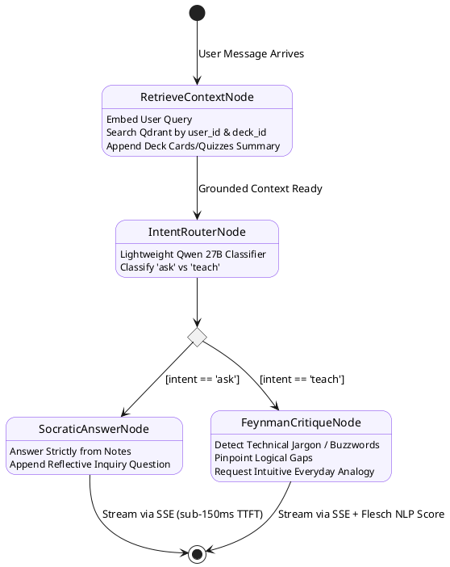

### Mermaid
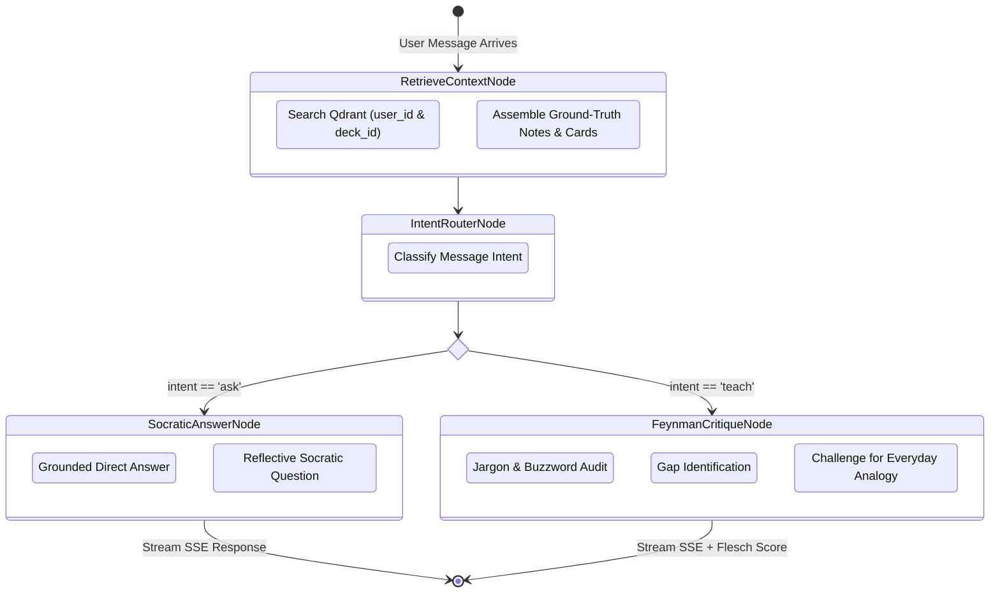

---

## 8. Empirical Cognitive Retention Curves Across Learning Modalities (Figure 6.1)

Literature benchmark synthesized from peer-reviewed cognitive psychology studies evaluating active recall, free-recall blurting, and distributed spaced practice (Roediger & Karpicke, 2006; Karpicke & Blunt, 2011; Cepeda et al., 2006).

### Mermaid
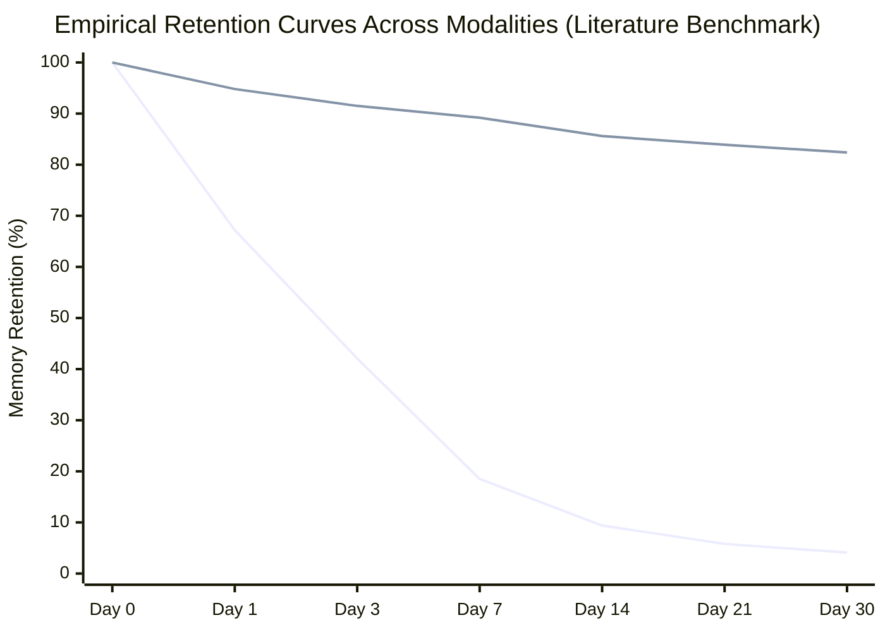

---

## 9. SuperMemo-2 Spaced Repetition and Predictive Calendar Scheduler State Machine (Figure 5.8)

### PlantUML
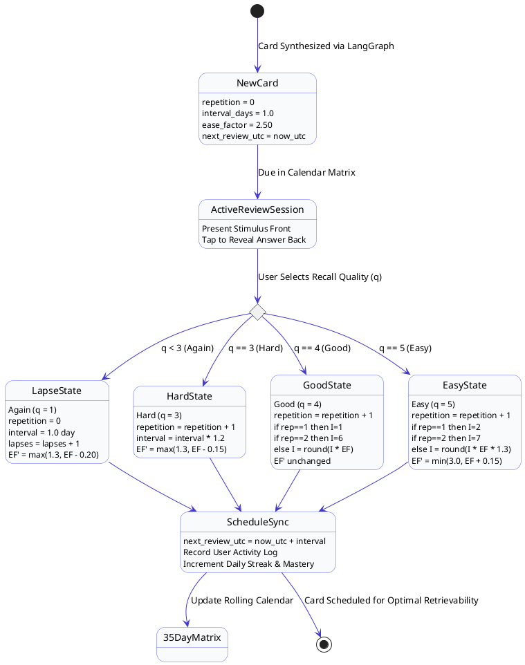

### Mermaid
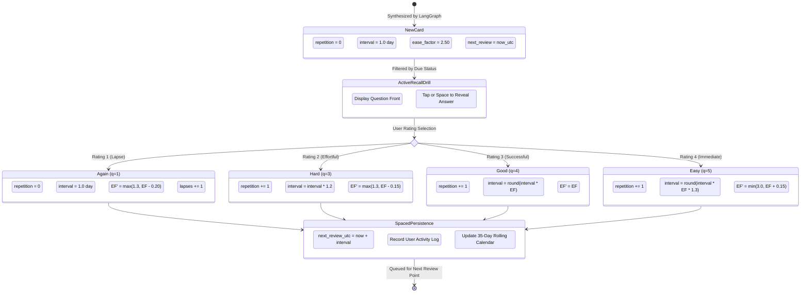

---

## 10. Graphical User Interface (UI) Snapshot Layouts and Specifications

This section details the layout specifications, state bindings, and interaction models for the six production UI snapshot figures incorporated into `documentation/Report.tex`:

### 10.1 Diagnostic Multiple-Choice Quiz Interface (`figures/ui_quiz.png`)
- **Report Reference**: Figure 5.5
- **Primary Source Component**: `frontend/src/routes/quiz.tsx` (`QuizPage`)
- **Key Visual Elements**:
  - Progress tracker and active score counter (`Question X of Y`, running correctness percentage).
  - High-yield conceptual stem synthesized via `generator_graph.py`.
  - Four candidate response tiles with letter badges (`A`, `B`, `C`, `D`). Correct response rendered with emerald border/background; incorrect distractors flagged with crimson state upon selection.
  - Expandable conceptual rationale accordion displaying the ground-truth document excerpt and pedagogical explanation.

### 10.2 Central Dashboard and Study Deck Workspace (`figures/ui_dashboard.png`)
- **Report Reference**: Figure 5.7
- **Primary Source Component**: `frontend/src/routes/index.tsx` (`Dashboard`), `DeckModal.tsx`, `FolderModal.tsx`
- **Key Visual Elements**:
  - Four top-level metric summary tiles: Active Cognitive Mastery, Consecutive Streak, Due Cards Today, Ingested Contexts.
  - Adaptive study deck grid organized by user-defined, color-coded folders (`Indigo`, `Emerald`, `Violet`, `Amber`, `Rose`, `Sky`).
  - Per-deck card metadata: total card count, quiz item count, attached source document badges, and retention stability progress bar.
  - Direct action triggers launching Flashcards, Diagnostic Quizzes, or the Blurt Arena.

### 10.3 Timed Blurt Mode Arena and Retention Audit (`figures/ui_blurt.png`)
- **Report Reference**: Figure 5.9
- **Primary Source Component**: `frontend/src/routes/blurt.tsx` (`BlurtPage`)
- **Key Visual Elements**:
  - Two-stage layout: Left panel features the active free-recall typing arena with countdown timer, word counter, and distraction-free editor.
  - Right panel visualizes the AI Semantic Audit Report produced by `blurt_graph.py`.
  - Global retention coverage score ring (percentage of retrieved high-yield concepts).
  - Green concept pills for successfully retrieved principles; red concept pills for identified knowledge voids/omissions.
  - Formative pedagogical coaching box providing targeted review recommendations.

### 10.4 Socratic and Feynman Interactive Tutor Drawer (`figures/ui_feynman_chat.png`)
- **Report Reference**: Figure 5.11
- **Primary Source Component**: `frontend/src/components/mneme/ChatDrawer.tsx`
- **Key Visual Elements**:
  - Slide-over global drawer accessible across all platform views without interrupting study flow.
  - Real-time client-side NLP panel computing the Flesch Reading Ease score, average syllables per word, sentence complexity, and jargon penalty.
  - Conversational message stream powered by Server-Sent Events (SSE) with token streaming from Groq Qwen 27B.
  - Dual persona switch: Socratic guided inquiry vs Richard Feynman analogy and plain-language critique.

### 10.5 Active Recall Flashcard Practice Studio (`figures/ui_flashcards.png`)
- **Report Reference**: Figure 5.13
- **Primary Source Component**: `frontend/src/routes/flashcards.tsx` (`FlashcardsPage`)
- **Key Visual Elements**:
  - 3D perspective flip card container with clean separation between front prompt stimulus and hidden back answer.
  - SuperMemo-2 metric indicators displaying repetition number, current interval, and Ease Factor (`R2 · Next: ~6d · EF 2.50`).
  - Four-tier tactile grading dock: `Again` (1d reset), `Hard` (1.2x), `Good` (standard EF), and `Easy` (1.3xEF bonus).
  - Tactile keyboard navigation shortcuts (Space to flip, 1-4 for ratings) and due-only filtering toggle.

### 10.6 Predictive Spaced Repetition Calendar and Date Inspection Modal (`figures/ui_calendar_schedule.png`)
- **Report Reference**: Figure 5.15
- **Primary Source Component**: `frontend/src/components/mneme/SpacedScheduleModal.tsx` (`SpacedScheduleModal`, `DateDetailModal`)
- **Key Visual Elements**:
  - Top statistical strip: Current Streak, Due Today, Fleet Average Ease Factor, Aggregate Retrievability ($R$).
  - 35-day continuous rolling calendar matrix showing 14 historical days, current day status, and 20 projected days with status badges (`completed`, `due`, `rest`).
  - Literature-grounded daily active recall task queue (SM-2 review, Blurt sprint, Feynman teaching, Diagnostic quiz).
  - `DateDetailModal` overlay listing individual cards due on a selected date, complete with front prompts, collapsible back answers, SM-2 badges, and a direct review launcher deep-linking to the target deck (`/flashcards?deckId=...`).
