# Mneme Architecture and Workflow Diagram Specifications

This document provides production-ready **PlantUML** and **Mermaid** source code blocks for all architectural and workflow diagrams referenced in `documentation/Report.tex`. You can paste these directly into PlantUML editors (e.g. [planttext.com](https://www.planttext.com/) or the PlantUML CLI) or Mermaid previewers (e.g. [mermaid.live](https://mermaid.live/)) to render high-resolution PNG or SVG figures for your project submission.

---

## 1. System Microservices Architecture (Figure 5.1)

### PlantUML
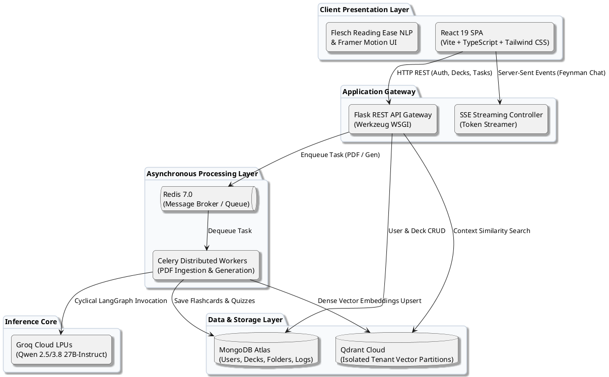

### Mermaid
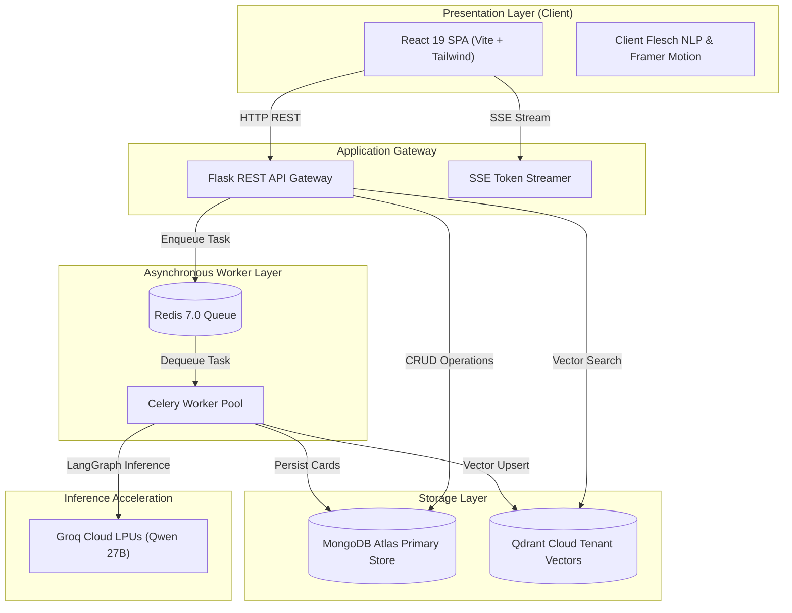

---

## 2. Use Case Workflow Diagram (Figure 5.2)

### PlantUML
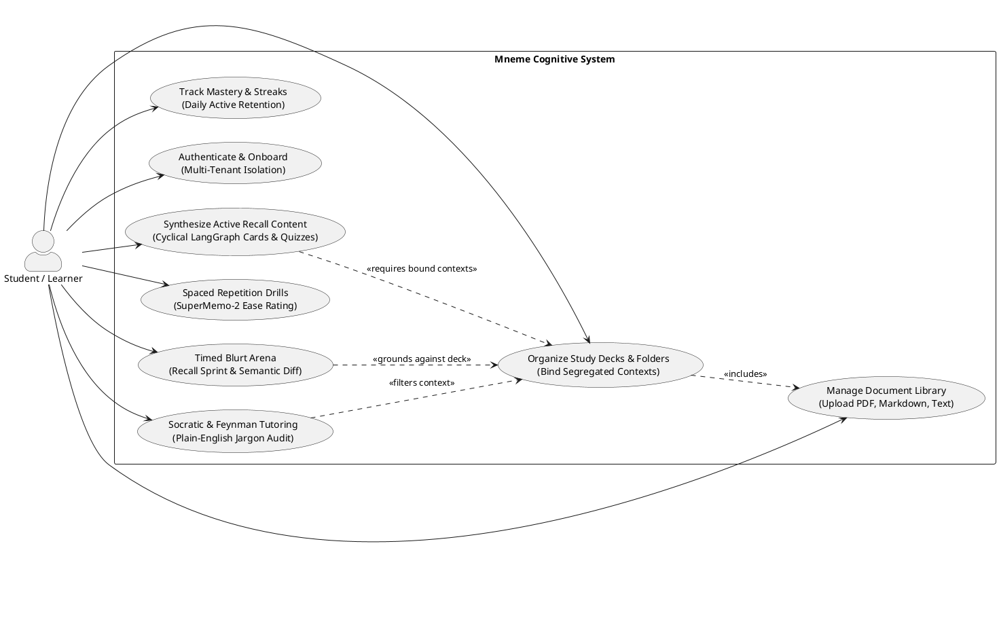

### Mermaid
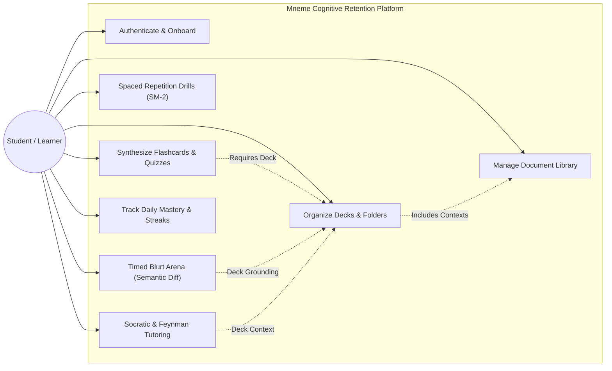

---

## 3. Ingestion & Retrieval Pipeline Sequence Diagram (Figure 5.3)

### PlantUML
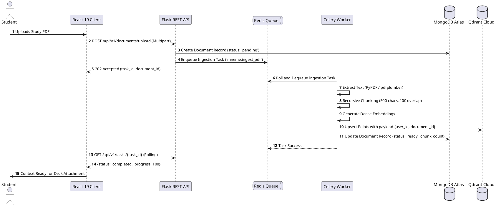

### Mermaid
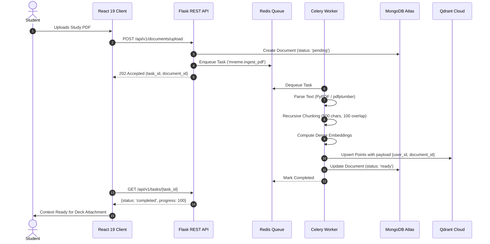

---

## 4. Cyclical LangGraph State Machine Workflow: Generator (Figure 5.4)

### PlantUML
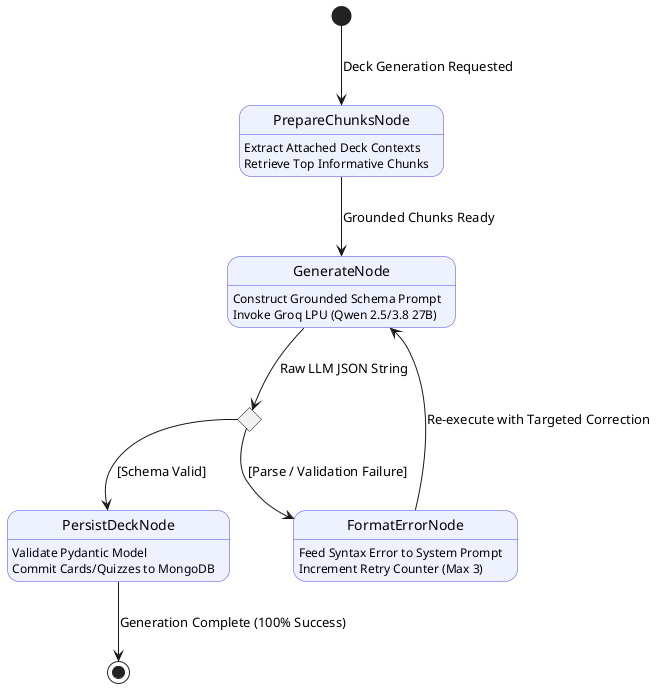

### Mermaid
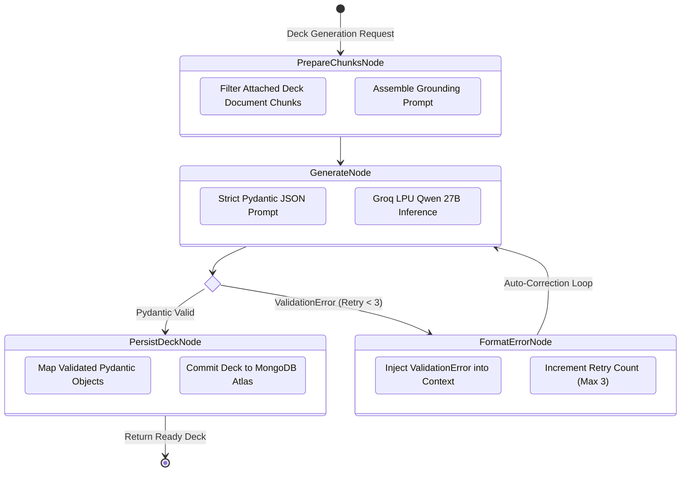

---

## 5. Entity-Relationship (ER) Schema Model (Figure 5.5)

### PlantUML
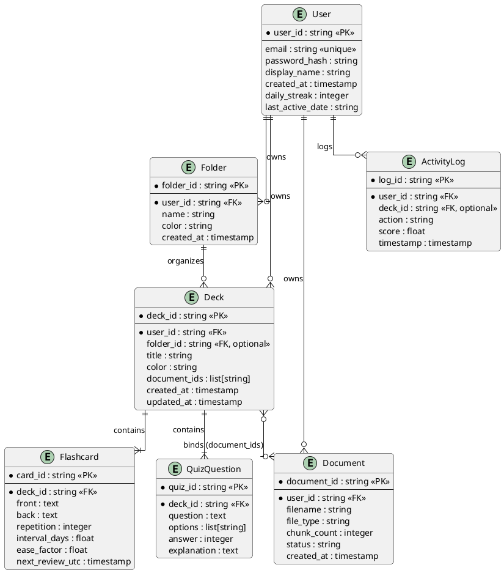

### Mermaid
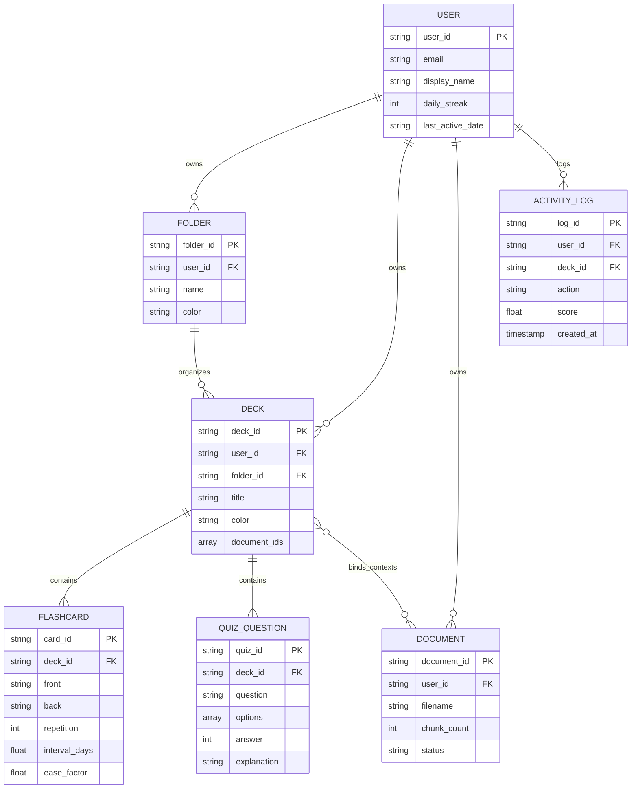

---

## 6. LangGraph Blurt Mode Cognitive Audit Workflow (Figure 5.6)

### PlantUML
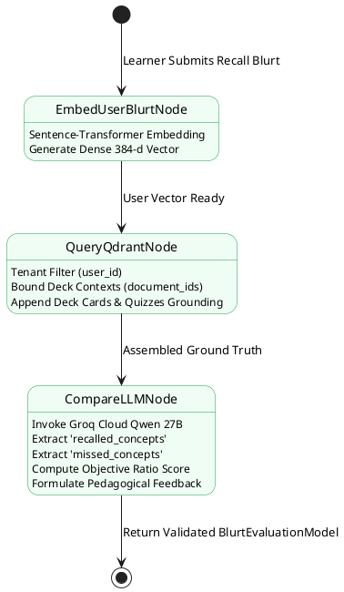

### Mermaid
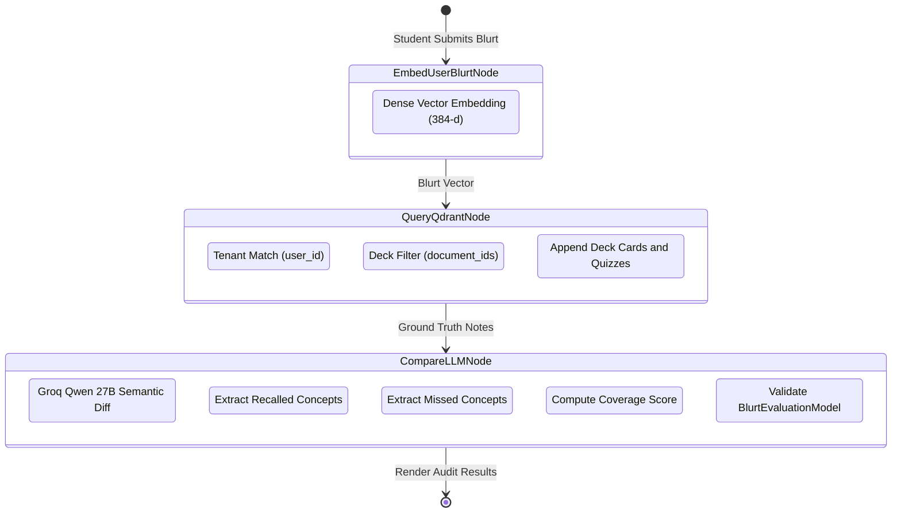

---

## 7. LangGraph Unified Socratic and Feynman Chat Workflow (Figure 5.7)

### PlantUML
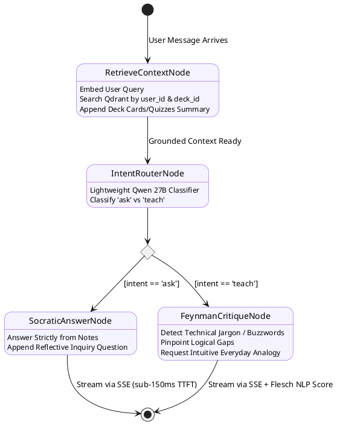

### Mermaid
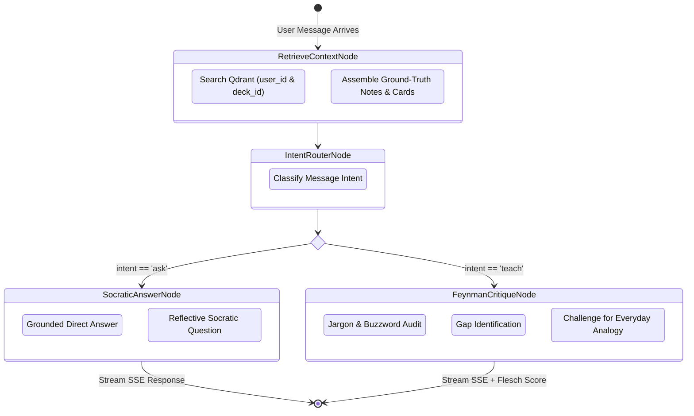

---

## 8. Empirical Cognitive Retention Curves Across Learning Modalities (Figure 6.1)

Literature benchmark synthesized from peer-reviewed cognitive psychology studies evaluating active recall, free-recall blurting, and distributed spaced practice (Roediger & Karpicke, 2006; Karpicke & Blunt, 2011; Cepeda et al., 2006).

### Mermaid
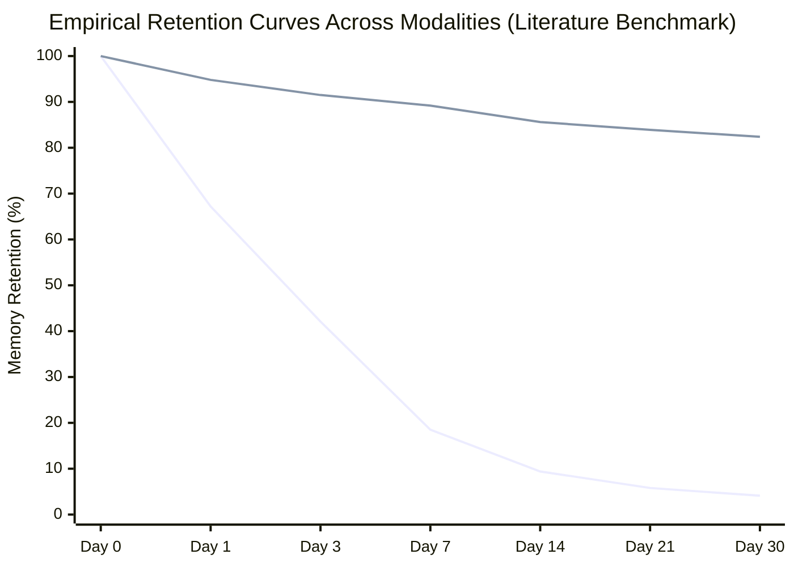
